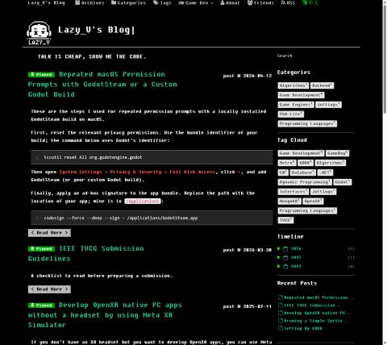

# freemind.bithack for Hugo

A dark, terminal-style blog theme — a Hugo port of [hexo-theme-freemind.bithack](https://github.com/Ares-X/hexo-theme-freemind.bithack). Same look, no Node and no jQuery: just the Hugo binary (≥ 0.146, standard edition is enough) and one 9 KB script.



**Features**: multilingual with language switcher · instant search (`/` or Ctrl+K) · RSS, Atom and JSON Feed with full text · build-time KaTeX math (MathML) · Mermaid · Chart.js charts · code blocks with copy button, language label and folding · heading anchors · sticky TOC with scroll spy · reading time, word count, reading progress · series navigation · related posts · prev/next with titles · breadcrumbs · image captions and lightbox · GitHub-style alerts · tabs / alert / badge / icon / video / pdf / bilibili / gallery / friend / embed shortcodes · giscus comments · page views · share buttons · analytics (GA, Umami, Plausible, GoatCounter, Cloudflare, Baidu) · Open Graph, Twitter cards, JSON-LD, hreflang · author card · year timeline · pinned posts · dropdown menus · print styles · web manifest.

Dark only, on purpose — it is the theme's identity.

## Quick start

```bash
git submodule add https://github.com/zzxzzk115/hugo-theme-freemind-bithack.git themes/freemind-bithack
```

Set `theme = "freemind-bithack"` and copy `[outputs]`, `[pagination]`, `[related]` and `[markup]` from [exampleSite/hugo.toml](exampleSite/hugo.toml) into your site config (Hugo does not merge those from themes). Every theme option is documented in [hugo.toml](hugo.toml).

Try the demo:

```bash
hugo server -s exampleSite --themesDir ../..
```

## License

[MIT](LICENSE). Based on hexo-theme-freemind.bithack (© 2015 blackshow, MIT) and hexo-theme-freemind (© 2013 Joseph Pan, MIT). Bundled assets keep their own licenses (see LICENSE).

---

## 中文说明

[hexo-theme-freemind.bithack](https://github.com/Ares-X/hexo-theme-freemind.bithack) 的 Hugo 移植版：外观保持原样（暗色终端风、像素字体），构建只要 Hugo 单文件，不需要 Node；前端不依赖 jQuery / Bootstrap JS，只有一个约 9 KB 的 `theme.js`。

只提供暗色，这是主题本身的风格。

### 功能

| 类别 | 功能 | 用法 / 配置 |
| --- | --- | --- |
| 列表 | 首页分页、摘要、置顶 | `<!--more-->` 或自动摘要（`autoExcerpt`）；`sticky: true` |
| | 归档、分类、标签、时间线 | `/archives/`（`layout: archives`）；侧边栏 `timeline` 挂件 |
| | 栏目页、面包屑 | 目录的 `_index.md`；`breadcrumbs` |
| 阅读 | 目录（默认开启，滚动高亮，桌面端吸附） | `tocDefault`；单篇 `toc: false` |
| | 标题锚点 | `headingAnchors` |
| | 代码块：复制、语言标签、长代码折叠；单行不显示行号 | `codeMaxLines`；单块 ```` ```go {collapse=false title="main.go"} ```` |
| | 字数、阅读时间、更新日期、原创标记、阅读进度条 | `lastmod`、`original: true` |
| | 系列导航（同一子目录下的文章） | `seriesNav`；单篇 `series: false` |
| | 上一篇 / 下一篇（显示标题，全站按时间） | |
| | 相关文章 | `relatedPosts` + 站点 `[related]` |
| | 图片注释（单独成段的图片用 title / alt 作 figcaption）、灯箱 | `imageCaptions` |
| | 在 GitHub 上编辑 | `editURL` |
| Markdown | 数学公式（构建时 KaTeX → MathML） | `math: true` 或 `math = "always"` |
| | Mermaid、Chart.js 图表 | ` ```mermaid `、` ```chart `（Chart.js JSON 配置） |
| | 提示框 `> [!TIP]`、`==标记==`、`H~2~O`、`x^2^`、脚注、emoji | 见 exampleSite 的 markup 配置 |
| 导航 | 即时搜索（`/` 或 Ctrl+K，方向键选择，关键词高亮） | 输出 `search.json` |
| | 下拉菜单、多语言切换 | 菜单项 `parent`；有译文跳译文 |
| | 作者卡片（头像、简介、统计、社交图标，微信号点击复制） | `authorCard`、`[[social]]`（`copy = "…"`） |
| 互动 | giscus / Valine 评论 | `[comments]` |
| | 阅读量（不蒜子 / Vercount） | `[pageviews] provider` |
| | 分享（X、LinkedIn、Reddit、Telegram、微博、邮件、复制链接） | `share` |
| | 统计（GA、Umami、Plausible、GoatCounter、Cloudflare、百度） | `[analytics]`，仅生产构建 |
| SEO / 订阅 | canonical、hreflang、Open Graph、Twitter Card、JSON-LD、sitemap、robots | 自动 |
| | RSS、Atom、JSON Feed（默认全文） | `[feed] fullText`、`limit` |
| 其他 | 打印样式、web manifest、移动端适配 | 自动 |

### 短代码

- `**Markdown**`：提示框
- `……`：标签页
- ``：徽章
- ``：行内 Font Awesome 4 图标
- ``、``、``、Hugo 自带的 ``
- ``：iframe，可嵌网页游戏
- `` 每行一个图片路径 ``：轮播图
- ``：友链卡片

### 扩展

所有扩展都放在**站点**目录里，不需要改主题：

- **短代码**：`layouts/_shortcodes/xxx.html`，同名覆盖主题自带的。
- **侧边栏挂件**：`layouts/_partials/widgets/<name>.html`，再把 `<name>` 加进 `params.widgets`。
- **渲染钩子**：`layouts/_markup/render-{link,image,heading,blockquote,passthrough,codeblock,codeblock-<lang>}.html`。
- **插入点**：`layouts/_partials/hooks/{head-end,footer-end,body-end}.html`。
- **样式**：`assets/css/custom.css` 自动打包进样式表末尾。
- **脚本**：`theme.js` 初始化后会在 `document` 上派发 `theme:ready` 事件。

### 依赖

| 依赖 | 版本 | 说明 |
| --- | --- | --- |
| Font Awesome | 4.7.0 | 只保留 woff2 / woff |
| Bootstrap CSS | 3.x（原主题定制版） | 只用样式；Bootstrap JS 已移除 |
| jQuery、fancyBox、imagesLoaded | 已移除 | 由 `theme.js` 替代 |
| Mermaid / Chart.js / KaTeX CSS | 11.4.1 / 4.4.1 / 0.16.22 | CDN，仅在用到的页面加载 |
