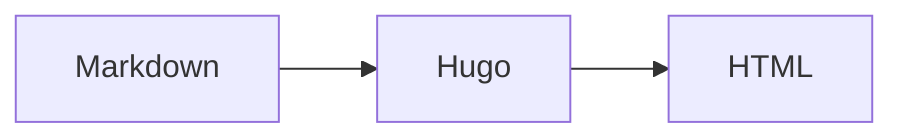

Everything the theme can render, on one page.

<!--more-->

## Alerts

> [!TIP]
> GitHub-style alerts become Bootstrap alerts.

> [!WARNING] Custom title
> Works with `NOTE`, `TIP`, `IMPORTANT`, `WARNING` and `CAUTION`.


The `alert` shortcode takes **Markdown** and code:

```bash
hugo server
```


## Tabs



```bash
brew install hugo
```


```powershell
winget install Hugo.Hugo.Extended
```



## Icons

-  `content/`
-  GitHub

## Math

Inline $e^{i\pi} + 1 = 0$, and a block:

$$
f(n) = g(n) + h(n)
$$

## Mermaid



## Code

```csharp
public static T Add<T>(T a, T b) where T : INumber<T> => a + b;
```

## Inline extras

==Marked==, ++inserted++, H~2~O, x^2^, a badge , an emoji :rocket:, and a footnote.[^1]

[^1]: Footnotes work out of the box.

## Chart

```chart
{ "type": "bar",
  "data": { "labels": ["2020", "2021", "2022"],
            "datasets": [{ "label": "Posts", "data": [21, 16, 17], "backgroundColor": "#2bbc8a" }] } }
```

## Long code (line numbers, copy button)

```text
line 1
line 2
line 3
line 4
line 5
line 6
line 7
line 8
line 9
line 10
line 11
line 12
line 13
line 14
line 15
line 16
line 17
line 18
line 19
line 20
line 21
line 22
line 23
line 24
line 25
line 26
line 27
line 28
line 29
line 30
line 31
line 32
```

## Images

A standalone image becomes a figure; the caption comes from its title or alt text. Click to open the lightbox.


## Friend links




Consecutive cards form an equal-size, two-column grid; `tags` is a comma-separated list.

## Collapsible block


The inside is regular Markdown: **bold**, `code`, lists and other shortcodes all work.

- one
- two


## Music player

Embed a NetEase Cloud Music song, album or playlist (artist pages can't be embedded):

```text


```

## Music player (APlayer)

A playlist of NetEase Cloud Music songs, streamed from NetEase's own outer link; titles and covers come from
`data/music.toml`. The cover turns like a record while a song plays.

```text


```



## itch.io game card

Same size and layout as itch.io's embed widget, drawn by the theme from `data/itch.toml`, so the page makes no
requests to itch.io:

```text

```



## Link card

```text

```



## Task list

- [x] Port the theme to Hugo
- [x] Pixel fonts for code too
- [ ] Write more posts
