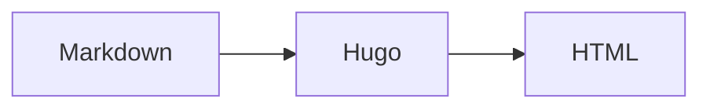

Everything the theme can render, on one page.

<!--more-->

## Alerts

> [!TIP]
> GitHub-style alerts become Bootstrap alerts.

> [!WARNING] Custom title
> Works with `NOTE`, `TIP`, `IMPORTANT`, `WARNING` and `CAUTION`.


The `alert` shortcode takes **Markdown** and code:

```bash
hugo server
```


## Tabs



```bash
brew install hugo
```


```powershell
winget install Hugo.Hugo.Extended
```



## Icons

-  `content/`
-  GitHub

## Math

Inline $e^{i\pi} + 1 = 0$, and a block:

$$
f(n) = g(n) + h(n)
$$

## Mermaid



## Code

```csharp
public static T Add<T>(T a, T b) where T : INumber<T> => a + b;
```

## Friend links


